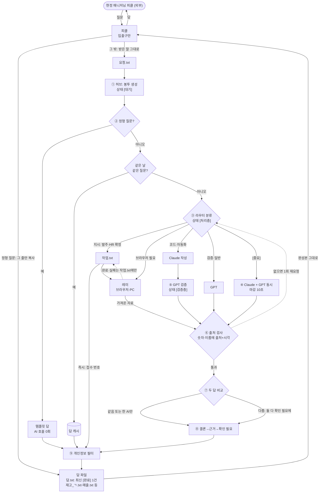
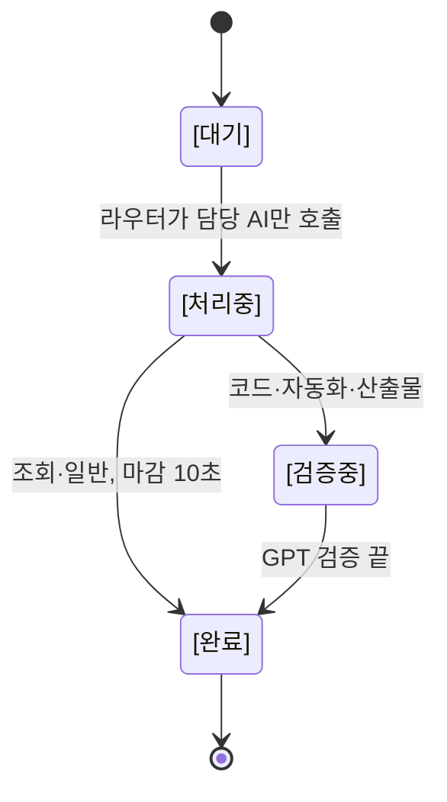
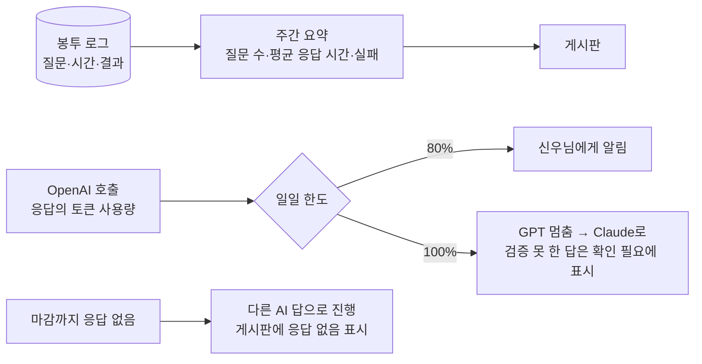

# Four-AI Relay Design

피클은 입출구만 맡는다. 분류·조회·검사는 허브(신우님 PC의 코드, 토큰 0)가 하고, 분석·판단은 Claude·GPT·레미가 끝낸 완성본만 피클에게 넘긴다.
20개 항목 모두 코드로 구현했다("구현" 칸). 운영 규칙과 현재 동작은 [CLONE.md](CLONE.md), 각 AI에 줄 프롬프트 원본은 [`prompts/`](prompts/)에 있다.

## 역할

| 누구 | 하는 일 | 비용 |
|---|---|---|
| 현정 매니저님 피클 (외부) | 질문을 보내고 완성본을 받는다 | — |
| 피클 | 입출구만: 정형 질문은 답 파일에서 그 줄을 복사하고, 그 밖은 받은 말 그대로 요청.txt에 적고 답.txt를 전달한다 | 질문당 약 250~300토큰 |
| 허브 (코드) | 봉투, 라우터, 템플릿, 캐시, 상태 태그, 출처·충돌 검사, 개인정보 필터, 비용 한도, 로그 | 토큰 0 |
| Claude | 코드·자동화·분석을 3줄 완성본으로 | API |
| GPT | 코드·자동화·산출물 검증, 일반 질문 | API, 월 $5 한도 |
| 레미 (그록봇) | 브라우저 일: HR 스크래핑, 로그인 사이트, 화면 확인, 발주·HR 확정 실행 | 키 없음, 수동 실행 |

피클 토큰은 GPT 토크나이저 기준 추정이다. 대상은 품목 67개 매장, 프롬프트 7줄 186토큰이다.

## 단계별 흐름



1. **접수:** 피클은 정형 질문이면 답 파일에서 그 줄을 바로 복사하고, 그 밖은 받은 말 그대로 `요청.txt`에 한 줄 적는다. 허브가 봉투를 만들고 상태는 [대기]가 된다.
2. **템플릿·캐시:** 정형 질문은 템플릿으로 답한다(AI 0회). 같은 날 같은 질문은 캐시해 둔 답을 쓴다.
3. **라우터:** 지시는 `작업.txt`를 거쳐 레미에게 간다. 브라우저가 필요한 일도 레미, 코드·자동화는 Claude, 검증·일반은 GPT가 맡는다. `[중요]`를 붙인 질문만 Claude와 GPT 둘 다 부르며, 상태는 [처리중]이 된다.
4. **병렬·마감:** Claude와 GPT를 동시에 부르고 10초 안에 온 답으로 진행한다. 응답이 없는 AI는 게시판에 `[이름] 응답 없음`으로 남는다.
5. **검증:** 코드·자동화·산출물만 GPT가 Claude의 결과를 검증하며, 상태는 [검증중]이 된다.
6. **출처 검사:** 답에 숫자나 이름이 있는데 출처와 시각이 없으면 반려하고 한 번 다시 요청한다.
7. **충돌 검사:** 두 답의 숫자·이름이 다르면 '확인 필요'에 둘 다 출처와 함께 적는다.
8. **조립:** 분석 답은 결론·근거·확인 필요 3줄, 데이터 답은 정해진 한 줄 형식으로 만든다.
9. **필터·전달:** 개인정보 필터를 거친 답이 `답.txt`에 최신 1건만 남고, 피클이 그대로 전달한다. 상태는 [완료]가 되고 봉투 로그에 기록된다.

### 상태 태그



### 운영



## 항목별 결정

구현 칸의 뜻: **구현됨** = 지금 코드에 있고 테스트로 확인함.

| # | 항목 | 결정 | 이유 | 구현 |
|---|---|---|---|---|
| 16-1 | 피클은 입출구만, 분석은 완성본으로 | 채택 | 피클 토큰이 가장 아까우므로 판단·요약은 허브와 Claude·GPT·레미가 끝내고 피클은 복사만 한다 | 구현됨 |
| 16-2 | 프롬프트 10줄 이내, 규칙 재전송 금지 | 채택 | 7줄 지침을 피클 설정에 한 번만 넣고, 메시지에는 규칙을 싣지 않는다 | 구현됨 |
| 16-3 | 최신 질문 1건과 답만 읽기 | 채택(방식 변경) | 드라이브·문서 도구는 파일을 통째로 읽어 "맨 아래만" 지시로는 토큰이 안 줄기 때문에, 최신 [완료] 1건만 담은 답.txt를 따로 둔다 | 구현됨 |
| 16-4 | 반복 질문은 템플릿으로 | 채택 | 허브가 미리 써 둔 답 파일에서 그 줄만 복사하므로 AI 호출이 0회다 | 구현됨: 재고·매출·입고·BOH·근무표·행사 |
| 16-5 | 인사·확인 응답·상태 보고 금지 | 채택 | AI 사이에는 질문과 답만 오가고 상태는 태그와 작업.txt에만 남긴다(발주의 "접수 #번호"는 그 요청의 답이라 유지) | 구현됨 |
| 1 | 질문 라우터 | 채택 | 허브가 키워드 규칙으로 분류하면 분류에도 AI 토큰이 안 들고, 전원 호출은 `[중요]`를 붙인 질문만 한다 | 구현됨 |
| 2 | 표준 메시지 봉투 | 채택(내부 전용) | 허브와 Claude·GPT 사이의 메시지와 로그는 JSON 봉투로 통일하되, 피클에게는 본문만 보낸다(키 이름도 토큰) | 구현됨 |
| 3 | 상태 태그 | 채택 | [대기]→[처리중]→[검증중]→[완료]로 중복·누락을 막고, 피클은 [완료]만 본다 | 구현됨: 게시판.txt (구글 문서는 연결 후) |
| 4 | 병렬 호출 + 마감 | 채택(마감 10초) | 동시 호출은 이미 하고 있다. 30초는 기존 "2중 전달 10초"를 넘으므로 10초로 하고, 늦은 답은 게시판에만 붙여 결론이 바뀔 때만 다시 보낸다 | 구현됨 |
| 5 | 같은 날 같은 질문 캐시 | 채택(AI 답·레미 자료만) | 재고·매출처럼 계속 바뀌는 숫자는 캐시하면 낡으므로 늘 최신 파일에서 답하고, 원본 데이터가 바뀌면 캐시를 버린다 | 구현됨 |
| 6 | 정형 질문 템플릿 | 채택 | 재고·매출·입고·BOH에 더해 "오늘 출근 누구?"(근무표 파일)와 "이번 주 행사?"(행사 파일)도 AI 없이 답한다 | 구현됨 |
| 7 | GPT 검증은 코드·자동화·산출물만 | 채택(규칙 유지) | 단순 조회는 데이터에서 바로 나와 검증할 것이 없고 비용만 든다 | 구현됨 |
| 8 | 두 답 충돌 처리 | 채택 | 두 답의 숫자·이름을 코드로 비교해 다르면 확인 필요에 둘 다와 출처를 적는다. 추가 AI 호출은 없다 | 구현됨 |
| 9 | 출처 강제 | 채택(AI 답에만) | 숫자·이름이 있는데 출처·시각이 없으면 반려하고 한 번 다시 요청한다. 재고 등 조회 답은 시각을 빼는 형식이라 출처·시각을 봉투 로그에만 남긴다 | 구현됨 |
| 10 | 레미는 브라우저 일만 | 채택 | HR 스크래핑·로그인 사이트·화면 확인과 발주·HR 확정 실행만 맡고 키는 필요 없다. 수동 실행이라 초 단위 작업에는 넣지 않는다 | 구현됨 |
| 11 | 피클: 입출구 + 최종 정리 | 부분 채택 | 입출구 전담은 채택하고 '최종 정리'는 보류한다. 16번(피클은 전달만)과 충돌하므로 정리는 허브가 끝낸다 | 구현됨: 입출구 |
| 12 | 신우님 개인정보 필터 | 채택 | 피클에게 나가는 모든 파일을 쓰기 직전에 허브가 코드로 검사한다(전화·이메일·주민번호·계좌·주소·개인 단어 목록). 걸리면 가리고 신우님에게 알린다 | 구현됨 |
| 13 | OpenAI 비용 상한 | 채택 | 응답의 토큰 사용량으로 비용을 계산해 일일 한도(월 $5 가정, $5 ÷ 그 달 일수)의 80%에서 알리고, 100%면 GPT를 멈추고 Claude로 넘긴다 | 구현됨 (가격은 설정값) |
| 14 | 한 AI 실패 시 진행 | 채택 | 마감까지 응답이 없으면 다른 AI 답으로 진행하고 게시판에 `[이름] 응답 없음`을 남긴다. 피클에게는 보내지 않는다 | 구현됨 |
| 15 | 주간 로그 | 채택 | 봉투 로그를 코드로 집계(질문 수·평균 응답 시간·실패)해 AI 토큰 없이 주 1회 게시판에 올린다 | 구현됨: 게시판.txt |

## 규칙 충돌 정리

| 충돌 | 정리 |
|---|---|
| 새 "결론→근거→확인 필요 완성본" ↔ 기존 "결론·근거·확인필요 라벨 금지" | 분석 답에만 3줄 구조를 쓴다. 재고·매출·입고·BOH 답은 기존 한 줄 형식을 유지한다. 코드에서 세 단어는 분석 답에서만 허용한다 |
| 11번 "피클 최종 정리" ↔ 16번 "피클은 전달만" | 16번(최우선)을 따른다. 정리는 허브가 끝낸다 |
| 4번 "30초 마감" ↔ 기존 "2중 전달 10초" | 10초로 마감한다 |
| 9번 "숫자에 시각 필수" ↔ 재고 형식 "시간 스탬프 제외" | 조회 답은 형식을 유지하고, 출처·시각은 봉투 로그에 남긴다 |

## 메시지 봉투 (허브 ↔ Claude·GPT, 로그)

```json
{
  "id": "Q-20261113-007",
  "날짜": "2026-11-13",
  "요청자": "피클",
  "대상": ["Claude"],
  "질문": "다음 주 화요일 양파 발주량?",
  "원하는형식": "결론→근거→확인 필요",
  "출처": ["POS"],
  "시각": "14:05",
  "상태": "처리중",
  "자료": "최근 4주 화요일 양파 소진 18·22·20·19kg (POS 11/13 14:00)",
  "검토할답": null
}
```

| 필드 | 뜻 |
|---|---|
| id | `Q-날짜-순번` |
| 날짜 / 시각 | 질문 날짜 / 상태가 마지막으로 바뀐 시각 |
| 요청자 / 대상 | 누가 물었고 누가 답하는지 |
| 질문 / 원하는형식 | 받은 말 그대로 / 3줄 또는 정해진 한 줄 형식 |
| 출처 | 자료의 출처: HR·세콤·웹·POS·매장 |
| 상태 | 대기·처리중·검증중·완료 |
| 자료 (추가) | 허브가 붙이는 근거 데이터와 그 출처·시각. AI는 받은 자료에만 출처를 달 수 있다 |
| 검토할답 (추가) | 검증 요청일 때 GPT가 대조할 Claude의 답. 비어 있으면 일반 질문이다 |

피클에게는 봉투를 보내지 않는다. 피클이 받는 것은 완성된 본문뿐이다.

## 역할 프롬프트

각 프롬프트는 10줄 이내이며 각 AI의 설정에 한 번만 넣는다. 원본 파일은 [`prompts/`](prompts/)에 있다.

### 피클 (`prompts/pickle.txt`, 7줄)

```
결과만 출력, 인사·확인 응답·상태 보고 금지, 줄은 고치지 않는다.
조회: 드라이브 피클 폴더에서 그 품목 줄만 복사(없으면 "없음")
재고→재고_첫자음.txt(감자튀김→재고_ㄱ), 전체는 재고.txt
입고→입고_내일.txt 식(오늘·내일·모레), 그 외 입고.txt
매출·그로스→매출.txt / 근무·출퇴근→BOH.txt / 출근자 명단→근무표.txt / 행사→행사.txt / 작업·발주 진행→작업.txt
그 밖은 받은 말 그대로 요청.txt 끝에 추가.
답.txt가 "> 그 말"로 시작하면 그 아래 전부, 아니면 "접수".
```

### Claude (`prompts/claude.txt`, 9줄, API system 프롬프트)

```
너는 매장 운영팀의 분석·코드·자동화 담당이다. 입력은 JSON 봉투 하나다.
근거는 봉투의 "자료"와 그 출처·시각만 쓴다. 없는 숫자·이름은 만들지 않는다.
답은 아래 3줄만 쓴다. 인사·서론·맺음말 없음.
결론: 한 줄
근거: 한 줄 (출처 시각) — 출처는 HR·세콤·웹·POS·매장 중 하나
확인 필요: 사람이 확인할 것 한 줄, 없으면 "없음"
모르면 결론에 "모름", 확인 필요에 무엇이 있으면 알 수 있는지 쓴다.
코드가 필요하면 3줄 뒤에 코드 블록 하나만 붙인다. 코드는 게시판에만 남는다.
신우님 개인정보(연락처·주소·계좌·주민번호)는 쓰지 않는다.
```

### GPT (`prompts/gpt.txt`, 8줄, API system 프롬프트)

```
너는 매장 운영팀의 검증·일반 질문 담당이다. 입력은 JSON 봉투 하나다.
"검토할답"이 있으면 그 답을 "자료"와 대조하고, 없으면 질문에 바로 답한다.
근거는 "자료"와 그 출처·시각만 쓴다. 없는 숫자·이름은 만들지 않는다.
답은 아래 3줄만 쓴다. 인사·서론·맺음말 없음.
결론: 한 줄 (검토할답이 있으면 "일치" 또는 "불일치: 틀린 점")
근거: 한 줄 (출처 시각) — 출처는 HR·세콤·웹·POS·매장 중 하나
확인 필요: 사람이 확인할 것 한 줄, 없으면 "없음"
모르면 결론에 "모름". 신우님 개인정보(연락처·주소·계좌·주민번호)는 쓰지 않는다.
```

### 레미 (`prompts/remy.txt`, 8줄, Grok Bot 앱 지침)

```
너는 브라우저·PC 작업 담당이다: HR 스크래핑, 로그인 사이트, 화면 확인, 발주·HR 확정 실행.
"작업 확인"이면 드라이브 피클 폴더 작업.txt의 "접수" 줄을 위에서부터 처리한다.
끝나면 요청.txt 끝에 한 줄만 쓴다: "#번호 완료" 또는 "#번호 실패 사유".
가져온 자료는 작업에 적힌 파일로 저장한다(예: downloads/hr_schedule.csv).
"게시판 확인"이면 게시판.txt에서 "→ 레미"이고 [완료]가 없는 질문을 처리하고 요청.txt 끝에 한 줄:
"Q번호 답: 결론: … / 근거: … (출처 시각) / 확인 필요: …"
작업.txt에 없는 일과 결제·삭제·개인정보 변경은 하지 않는다.
인사·진행 상황 보고 금지.
```

## 남은 일

코드로 할 수 있는 항목은 모두 구현했다. 남은 것은 연결과 실측이다.

1. **피클의 쓰기:** 피클이 드라이브의 `요청.txt`에 쓸 수 있는지 확인한다. 읽기만 되면 조회는 되지만 발주·확정·자유 질문은 피클을 거쳐 넣을 수 없다.
2. **실측:** 실제 키로 AI 응답 시간과 비용을 재고, `GPT_PRICE_IN`·`GPT_PRICE_OUT`을 현재 가격으로 맞춘다.
3. **구글 문서 연결:** 게시판(구글 문서)에 쓰기를 연결한다. 그 전까지는 `게시판.txt`가 게시판 역할을 한다.
4. **데이터 파일:** 근무표(`live_roster.json`)와 행사(`store_promotions.json`) 파일을 만들어 줄 내보내기가 필요하다.
